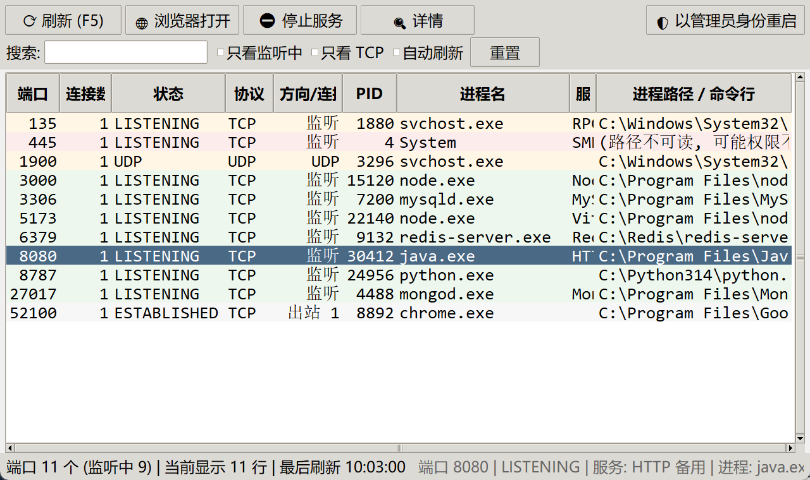

<div align="center">


**Windows 端口进程一键查看工具 —— 看清哪个端口被哪个程序占着，一键开浏览器，一键停服务。**

[](https://github.com/Mj00102/AAA-PortKing/actions/workflows/tests.yml)
[](LICENSE)
[](https://www.python.org/)
[](#)

[功能](#功能) · [快速开始](#快速开始) · [快捷键](#快捷键) · [原理](#实现原理) · [自己打包](#自己打包-exe)

</div>

---



## 这是什么

写代码时最烦的事之一：**某个端口被占了，却不知道是谁占的。**

`netstat -ano` 能看到 PID，但还得再去任务管理器里翻进程名；想打开 `8080` 上的服务，还要手敲网址。这个工具把这些合成一步：

- **双击即用**，不需要装 Python（下载 Release 里的 exe）
- 一眼看清 **端口 → 进程名 → 完整路径 → PID**
- 在那一行按 **`Ctrl + 左键`**，直接用默认浏览器打开这个端口的服务
- 选中一行点 **停止服务**，进程立刻结束、端口立刻释放

## 功能

### 一键查看端口进程

按 `F5` 刷新：直接向 Windows 内核要端口表，再反查每个端口的占用进程。

- 表格列：端口 / 连接数 / 状态 / 协议 / 方向 / PID / 进程名 / 服务识别 / 进程路径
- **服务识别**自动标注常见端口：`3306`→MySQL、`6379`→Redis、`8080`→HTTP 备用、`5173`→Vite 前端、`445`→SMB……
- 颜色区分：绿=监听中，灰=已建立连接，蓝=UDP，黄=系统进程，红=高危系统端口
- 同一端口被多个进程占用时，会列出全部 PID 和进程名
- 列表只显示**已经被占用**的端口 —— 没人监听的端口不会出现（这是正常的）

### Ctrl + 左键，直接开浏览器

在任意一行按 **`Ctrl + 左键`**（或直接双击）：

- 监听在 `127.0.0.1` 的 → 打开 `http://127.0.0.1:端口`
- 监听在 `0.0.0.0` 的 → 自动取本机 IP
- `443`/`8443` → 自动用 `https://`
- 鼠标悬停任意一行，底部会显示完整信息（端口 / 状态 / 服务 / 进程）

### 一键停止服务

选中端口那一行 → 点「停止服务」或按 `Delete`：

1. 弹出确认框，列出**每个将被结束的进程的 PID、名称、路径**
2. 先尝试原生 `TerminateProcess`，失败自动回退 `taskkill /F /T`
3. 结束后自动刷新，端口随即消失

**自保护**（避免手滑把系统搞崩）：

| 情况 | 行为 |
| --- | --- |
| `PID 0` / `PID 4`（系统内核） | 直接拒绝 |
| `lsass` / `csrss` / `winlogon` / `services` / `svchost` 等关键进程 | 直接拒绝并说明原因 |
| 本工具自身进程 | 直接拒绝 |
| 读不到进程名（身份未知） | 拒绝，提示改用管理员身份 |
| `explorer.exe` 等外壳进程 | 允许，但额外警告「会导致桌面重启」 |

### 其它

- **搜索**：按端口 / 进程名 / PID 过滤，支持空格分词（如 `node 5173`）
- **只看监听中** / **只看 TCP**：过滤掉瞬时连接
- **自动刷新**：每 5 秒重扫
- **右键菜单**：复制端口 / PID / 进程路径
- **详情窗口**：连接明细 + 进程命令行（从 PEB 读取）
- **以管理员身份重启**：一键 UAC 提权，能读到系统进程和停止系统服务

## 快速开始

### 方式一：下载 exe（推荐，不需要 Python）

到 [Releases](../../releases) 下载 `AAA端口大王-单文件版.zip`，解压后双击 `AAA端口大王.exe`。

需要停系统级服务时，右键 exe →「以管理员身份运行」。

> 首次运行会在 exe 同目录解压出 `PortKing-data\` 文件夹（约 28 MB 运行库，因为不依赖系统 Python）。
> 这是正常的，删掉它下次会自动重新解压。

### 方式二：从源码跑

```powershell
git clone https://github.com/Mj00102/AAA-PortKing.git
cd AAA-PortKing
python portking.py
```

只需要 **Python 3.8+**，用的是自带的 `tkinter` 和 `ctypes`，**不需要 pip install 任何东西**。

## 快捷键

| 快捷键 | 功能 |
| --- | --- |
| `F5` / `Ctrl+R` | 刷新 |
| `Ctrl + 左键` / 双击 | 在默认浏览器打开 |
| `Enter` / `Ctrl+O` | 打开选中端口 |
| `Delete` / `Ctrl+K` | 停止选中服务 |
| `Esc` | 取消选中 |
| 点列标题 | 按该列排序（再点切换升降序） |

## 权限说明

Windows 默认不允许普通用户读取其它用户/系统进程的信息，所以：

- **能读到**：你自己启动的服务（node、python、java、MySQL 等）
- **读不到**：系统进程 —— 进程名会显示 `<需管理员权限 (PID N)>`，
  状态栏会提示「建议以管理员身份重启」，点右上角按钮即可提权

## 实现原理

<details>
<summary><b>为什么用内核 API 而不是 netstat（快 24 倍）</b></summary>

原版每次刷新要启动一次 `netstat.exe` 子进程，实测 **90 ms**。现在直接调用
`GetExtendedTcpTable` / `GetExtendedUdpTable`：

| 方式 | 耗时 |
| --- | --- |
| `netstat -ano` 子进程 | 90 ms |
| **内核 API 直查** | **3.8 ms** |

`netstat` 仍保留为兜底（API 异常时自动回退，功能不会丢）。

正确性用 430 条连接逐条比对：**协议/地址/端口/状态 100% 一致**，另测了 IPv6 解析。

踩过的坑（都已在代码注释里标注）：

- Windows 的 `DWORD` 是 4 字节，用 `ctypes.c_ulong`（64 位下 8 字节）会导致行内偏移全乱
- IPv6 地址在结构体里占 **4 个 DWORD 槽**，偏移必须按槽累加
- UDP 的行步长是 `12`（IPv4）/ `28`（IPv6），和 TCP 的 `24`/`56` 不同
- 端口表在两次 API 调用之间会变大，所以必须重试 + 边界钳制

</details>

<details>
<summary><b>为什么不用 PyInstaller 的 --onefile</b></summary>

`--onefile` 每次启动都要把自己解包到 `%TEMP%`。在某些临时目录受限的机器上会直接报
`Could not create temporary directory!` 而**完全打不开**（实测连 20 行的 hello-world
onefile 都同样报错，与本项目无关）。

所以单文件版采用**自解压启动器**方案：

```
C# 启动器 (9 KB)  +  内嵌 12 MB zip 负载  =  一个 exe
     ↓ 首次运行
解压到 exe 同目录的 PortKing-data\  (完全不碰 %TEMP%)
     ↓ 之后
用负载哈希当版本指纹，命中就不再解压
```

解压目录按优先级**实测可写性**：用户 AppData → exe 所在目录 → 当前目录。

源码见 [`tools/launcher.cs`](tools/launcher.cs)。

</details>

<details>
<summary><b>响应式列宽是怎么算的</b></summary>

窗口变宽时按基础宽度比例分配多余空间；窗口变窄时，**每列按自己"完整显示所需宽度"
等比缩放**，而不是所有列用同一个系数 —— 否则会出现明明有空间、`LISTENING` 却被截成
`LISTENIN` 的情况。

状态列是硬需求，保底 180px（保证 `ESTABLISHED` 完整显示）；路径列允许截断，完整值在「详情」里看。

</details>

<details>
<summary><b>其它工程细节</b></summary>

- **不依赖 `tasklist` / WMI**：某些受限环境下 `tasklist` 会被拒绝访问，
  所以主路径用 `kernel32` 原生 API 读进程路径，`tasklist` 只做兜底
- **DPI 感知**：启动时开启 `SetProcessDpiAwareness`，避免高分屏下窗口被缩放导致排版错位
- **无控制台窗口**：所有子进程调用都带 `CREATE_NO_WINDOW`
- **列宽按实测字宽**：用 `tkfont.measure()` 算真实像素，不靠经验估
  （这个 DPI 下 Consolas 10 的 `LISTENING` 实测 135px）

</details>

## 自己打包 exe

双击 **`打包exe.bat`** 即可，它会自动装 PyInstaller、打文件夹版、再生成单文件版。

手动等价命令：

```powershell
python -m pip install pyinstaller

# 1) 文件夹版
python -m PyInstaller --onedir --noconsole --name PortKing `
  --icon "..\assets\app.ico" --add-data "..\assets\app.ico;." `
  --distpath "dist" --workpath "tools\pyi-work" --specpath "tools" portking.py

# 2) 单文件版 = 文件夹版 + 自解压启动器
python tools\make_onefile.py

# 图标 / 截图 (可选)
python tools\make_icon.py
python tools\make_screenshot.py
```

> `--icon` 和 `--add-data` 的路径是相对 **spec 所在目录**解析的，
> 因为 spec 放在 `tools\`，所以要写 `..\assets\app.ico`。

## 测试

```powershell
python test_portking.py
```

覆盖 37 项：地址解析、服务识别、内核 API 与 netstat 一致性、真实 HTTP 服务全链路
（扫描 → 识别进程 → 生成浏览器地址 → 结束进程 → 验证端口释放）、危险进程保护。

CI 在 Windows + Python 3.9/3.12 上跑这套测试（见 `.github/workflows/tests.yml`）。

## 目录结构

```
AAA-PortKing/
├─ portking.py               主程序 (单文件, 只用标准库)
├─ test_portking.py          自测脚本
├─ 启动.bat                   双击启动 exe
├─ 打包exe.bat                重新打包
├─ assets/
│   ├─ app.ico               应用图标 (由 tools/make_icon.py 生成)
│   ├─ banner.svg            README 头图
│   └─ screenshot.png        界面截图
└─ tools/
    ├─ launcher.cs           单文件自解压启动器 (C#)
    ├─ make_onefile.py       合成单文件 exe
    ├─ make_icon.py          生成图标
    └─ make_screenshot.py    生成截图
```

## 已知限制

- 只支持 **Windows**（深度使用了 Windows 内核 API、PEB、`TerminateProcess`）
- 列表只显示已占用的端口，不显示空闲端口
- 结束进程需要管理员权限才能操作系统级进程
- 单文件版首次启动需要解压（约 3~4 秒），之后约 1.5 秒；想要更快就用文件夹版

## 贡献

欢迎提 Issue 和 PR。改代码后请跑一遍 `python test_portking.py`。

## License

[MIT](LICENSE)
